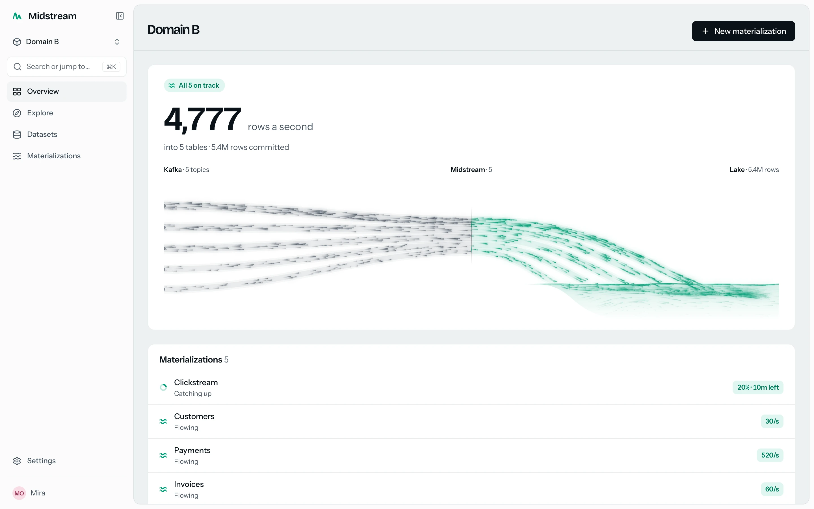
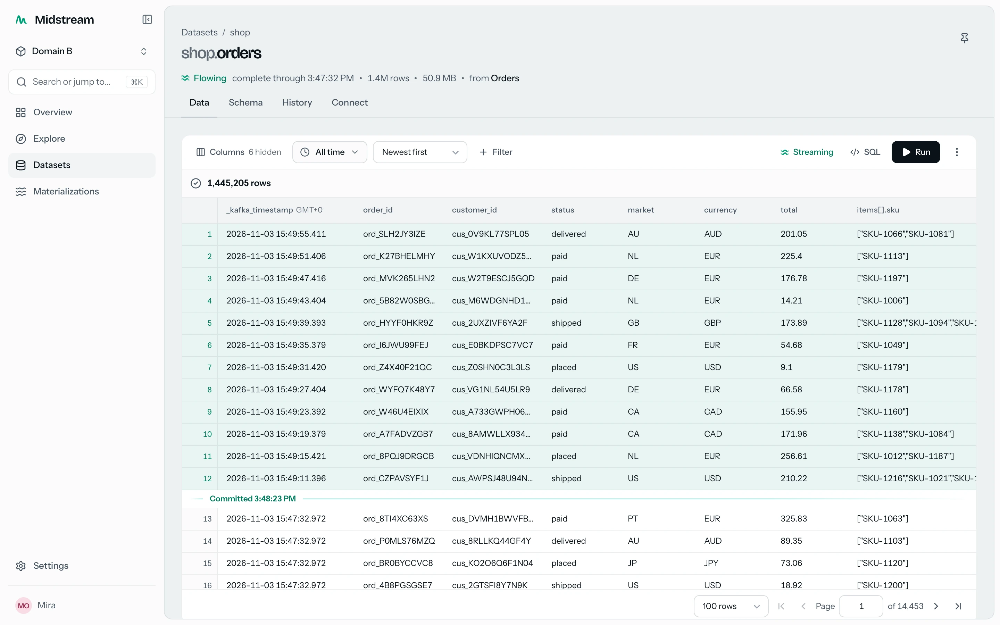
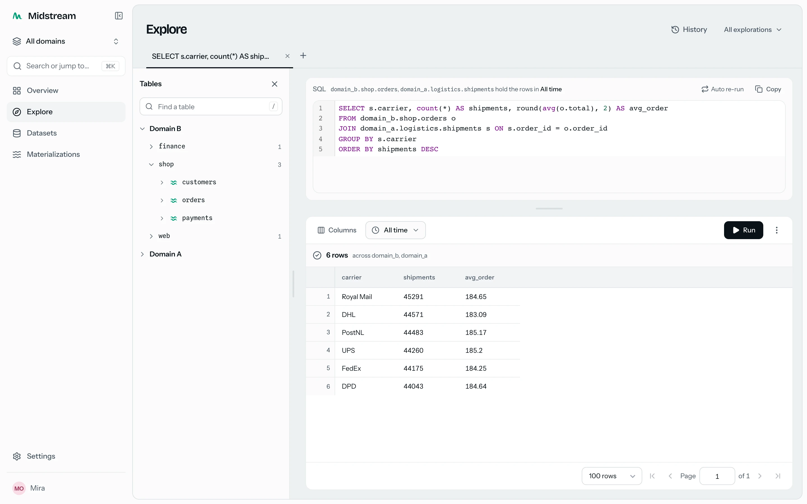
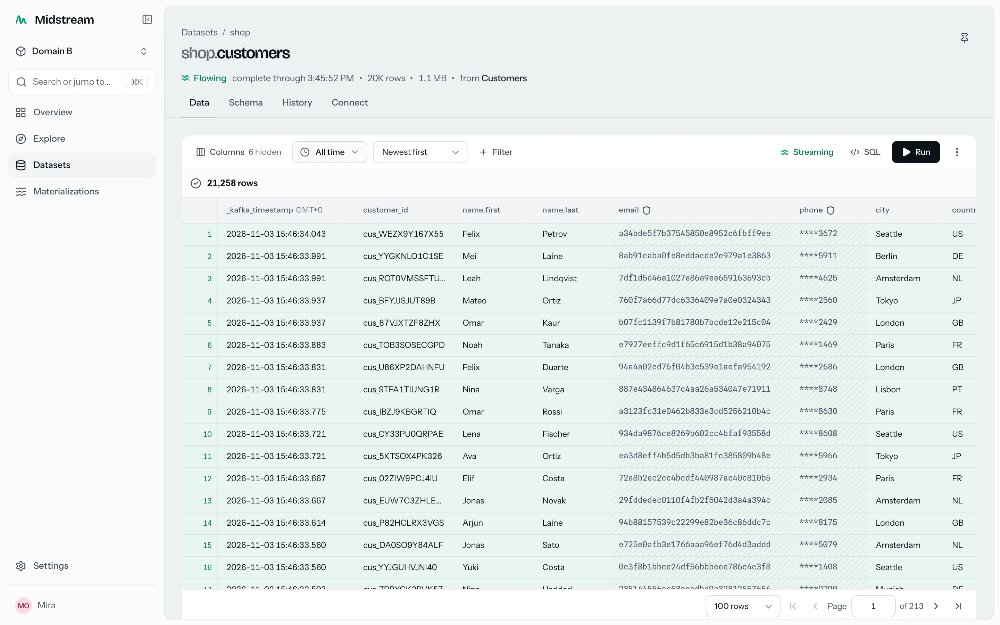
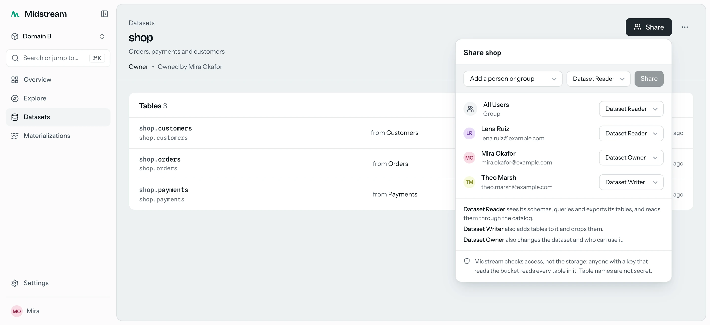

<p align="center">
  <picture>
    <source media="(prefers-color-scheme: dark)" srcset="console/design/mark/lockup-dark.svg">
    
  </picture>
</p>

<p align="center">
  Kafka topics into Apache Iceberg tables, exactly once.<br>
  Live in the console within seconds. Readable by any Iceberg engine.
</p>

<p align="center">
  <a href="docs/install.md">Install</a> ·
  <a href="docs/handbook/README.md">Handbook</a> ·
  <a href="console/docs/README.md">Console handbook</a> ·
  <a href="https://github.com/vmirz/midstream/releases">Releases</a>
</p>

<picture>
  <source media="(prefers-color-scheme: dark)" srcset="docs/assets/readme/overview-dark.webp">
  
</picture>

## Every topic, a table

- A **materialization** reads Kafka topics, each into an Iceberg table, every record exactly once
- Schemas read from the data, and evolved as it changes
- Google Cloud Storage, Amazon S3 and S3-compatible stores, Azure Blob Storage
- Partitioned by hour, day or month; small files merged and old versions pruned on their own

## Live within seconds

- New records reach the console within seconds, before they commit, each exactly once
- The waterline: rows above it are live; rows below it are committed, and any Iceberg engine reads them

<picture>
  <source media="(prefers-color-scheme: dark)" srcset="docs/assets/readme/table-dark.webp">
  
</picture>

## Ask the data

- SQL in the browser over any table, joined across datasets and domains
- Exact counts, rows as they arrive, export to CSV, JSON or Parquet
- An Iceberg REST catalog for DuckDB, PyIceberg and other Iceberg engines

<picture>
  <source media="(prefers-color-scheme: dark)" srcset="docs/assets/readme/explore-dark.webp">
  
</picture>

## Data protection

- Emails, phone numbers, card numbers, national IDs and secrets, recognised by field name
- Masked before anything is written: hashed, partial or withheld
- A policy per materialization; change it, and rows already written are masked too

<picture>
  <source media="(prefers-color-scheme: dark)" srcset="docs/assets/readme/protection-dark.webp">
  
</picture>

## Access

- Single sign-on: Microsoft Entra ID, GitHub, Google, or any OpenID Connect provider
- Roles and groups, with permissions granted per dataset
- Share a dataset the way you share a document
- Invitations by email, access tokens for engines and scripts, an audit log

<picture>
  <source media="(prefers-color-scheme: dark)" srcset="docs/assets/readme/share-dark.webp">
  
</picture>

## One console, every domain

- A **domain** per team or cluster, each with its own accounts, data and settings
- One console over all of them: one sign-in, search, SQL and one Iceberg catalog across domains

## Runs on Kubernetes

- One Helm chart: a domain, the console, or both
- More workers while a backlog lasts; CPU requests that follow use
- Built on [Kaspr](https://kaspr.dev)

## Install

You need Kubernetes 1.29 or later, [kaspr-operator](https://kaspr.dev) 0.19.7 or later, a Kafka
cluster and an object store. [docs/install.md](docs/install.md) takes an empty namespace to a first
table: the Secrets, your store, the values, then

```bash
helm install midstream oci://ghcr.io/vmirz/charts/midstream --version <version> \
  -n midstream -f midstream-values.yaml
```

Each release publishes the chart, the Python package (`midstream-platform` on PyPI) and the console
image (`ghcr.io/vmirz/midstream-console`).

## Documentation

- [Install](docs/install.md): an empty namespace to a first table, on each object store
- [Handbook](docs/handbook/README.md): 22 documents on architecture, the API, operations, identity, the live tail and data protection
- [Console handbook](console/docs/README.md): 17 documents on every screen, its configuration and the design language
- [Contributing](CONTRIBUTING.md): how changes are made; [AGENTS.md](AGENTS.md) holds the conventions
- [Security](SECURITY.md): reporting a vulnerability

## Development

```bash
# Python: the package in place, then the tests
python3.12 -m venv .venv && .venv/bin/pip install -r requirements-dev.txt
.venv/bin/python -m unittest discover -s python/tests -p 'test_*.py'

# Chart: lint and render
helm lint charts/midstream -f charts/midstream/ci/test-values.yaml
helm template midstream charts/midstream -n midstream -f charts/midstream/ci/test-values.yaml

# Console: against a control plane (with no registry it serves one domain, local, at :6065)
kubectl -n midstream port-forward svc/midstream-control-plane-app-api 6065:6065
cd console && npm install && npm run dev
```

## License

[MIT](LICENSE)
